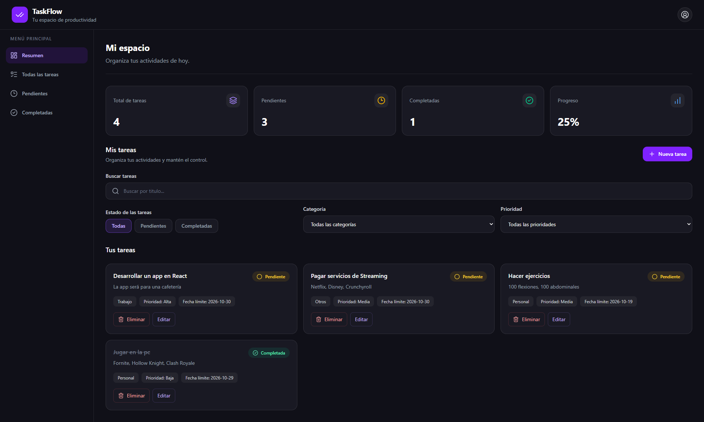

# TaskFlow — Gestor de tareas

TaskFlow es una aplicación web de gestión de tareas desarrollada con React, TypeScript y Tailwind CSS. Permite organizar actividades, establecer prioridades, realizar un seguimiento del progreso y mantener las tareas guardadas en el navegador.

El proyecto fue creado como práctica para profundizar en React, el manejo del estado, los componentes reutilizables y la organización de la lógica mediante hooks personalizados.

## Vista previa



## Demo

- **Aplicación desplegada:** https://taskflowljpr.netlify.app/

## Funcionalidades

- **Gestión de tareas (CRUD):** crear, visualizar, editar y eliminar tareas.
- **Control de estado:** marcar tareas como completadas o pendientes.
- **Categorías:** organizar actividades por Trabajo, Estudio, Personal y Otros.
- **Prioridades:** asignar niveles de prioridad baja, media o alta.
- **Fechas límite:** registrar la fecha prevista para cada tarea.
- **Búsqueda:** encontrar tareas mediante su título.
- **Filtros combinados:** filtrar tareas por estado, categoría y prioridad.
- **Panel de resumen:** visualizar el total de tareas, las pendientes, las completadas y el porcentaje de progreso.
- **Navegación lateral:** acceder a las vistas de resumen, todas las tareas, pendientes y completadas.
- **Confirmación de eliminación:** solicitar confirmación antes de eliminar una tarea.
- **Persistencia local:** guardar las tareas en `localStorage` para conservarlas al recargar la página.
- **Formulario reutilizable:** utilizar el mismo formulario para crear y editar tareas.

## Tecnologías utilizadas

| Tecnología | Uso |
|---|---|
| React | Construcción de la interfaz mediante componentes. |
| TypeScript | Tipado estático y definición de tipos para las tareas y sus propiedades. |
| Vite | Herramienta de desarrollo y compilación. |
| Tailwind CSS | Diseño y estilos de la interfaz. |
| Lucide React | Iconografía de la aplicación. |
| React Hooks | Manejo del estado y los efectos secundarios. |
| Custom Hooks | Centralización de la lógica de gestión de tareas en `useTasks`. |
| localStorage | Persistencia de los datos en el navegador. |

## Conceptos de React aplicados

Durante el desarrollo se trabajaron los siguientes conceptos:

- **Componentes reutilizables:** división de la interfaz en elementos independientes, como la barra de navegación, el menú lateral, las tarjetas de resumen y la lista de tareas.
- **Props:** comunicación entre componentes mediante propiedades tipadas.
- **`useState`:** gestión del estado de las tareas, los filtros, la búsqueda y los formularios.
- **`useEffect`:** sincronización de las tareas con `localStorage`.
- **Custom Hooks:** separación de la lógica de negocio de la interfaz mediante el hook `useTasks`.
- **Renderizado dinámico:** generación de elementos a partir de arreglos de datos mediante `.map()`.
- **Renderizado condicional:** visualización de secciones según la opción seleccionada y el estado de la aplicación.
- **TypeScript:** definición de tipos para las tareas y sus categorías y prioridades.

## Estructura del proyecto

```text
src/
├── components/   # Componentes reutilizables de la interfaz
├── hooks/        # Hooks personalizados
│   └── useTasks.ts
├── types/        # Tipos e interfaces de TypeScript
│   └── task.ts
├── App.tsx       # Componente principal y coordinación de la interfaz
└── main.tsx      # Punto de entrada de React
```

> La estructura puede variar según la organización final de los archivos del proyecto.

## Requisitos previos

Antes de ejecutar el proyecto, asegúrate de tener instalado:

- [Node.js](https://nodejs.org/) (versión compatible con la versión de Vite utilizada).
- npm, incluido con Node.js.
- Git, si deseas clonar el repositorio.

## Instalación y ejecución

### 1. Clonar el repositorio

```bash
git clone <URL_DEL_REPOSITORIO>
```

### 2. Entrar en la carpeta del proyecto

```bash
cd taskflow
```

Si tu repositorio tiene otro nombre, utiliza el nombre correspondiente.

### 3. Instalar las dependencias

```bash
npm install
```

### 4. Iniciar el servidor de desarrollo

```bash
npm run dev
```

Vite mostrará en la terminal la dirección local para abrir la aplicación en el navegador.

### 5. Generar la versión de producción

```bash
npm run build
```

Para comprobar localmente la versión compilada, puedes ejecutar:

```bash
npm run preview
```

## Persistencia de datos

TaskFlow utiliza `localStorage` para almacenar las tareas en el navegador. Los datos se guardan automáticamente cuando cambia el estado de las tareas.

La información permanece disponible al recargar la página en el mismo navegador y origen. Como la persistencia es local, las tareas no se sincronizan automáticamente entre dispositivos ni navegadores.

## Posibles mejoras futuras

- Implementar autenticación y cuentas de usuario.
- Sincronizar las tareas mediante una base de datos.
- Añadir notificaciones para las fechas límite.
- Incorporar ordenamiento por fecha, prioridad y creación.
- Añadir pruebas automatizadas.
- Mejorar la accesibilidad y la experiencia en dispositivos móviles.

## Autor

Desarrollado como proyecto de práctica para fortalecer conocimientos de React, TypeScript y desarrollo frontend.

---

**TaskFlow** — Organiza tus tareas, prioriza tus objetivos y sigue tu progreso.